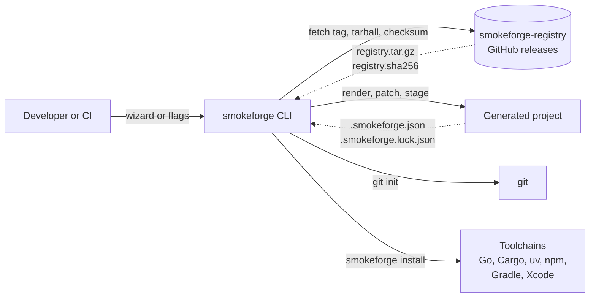
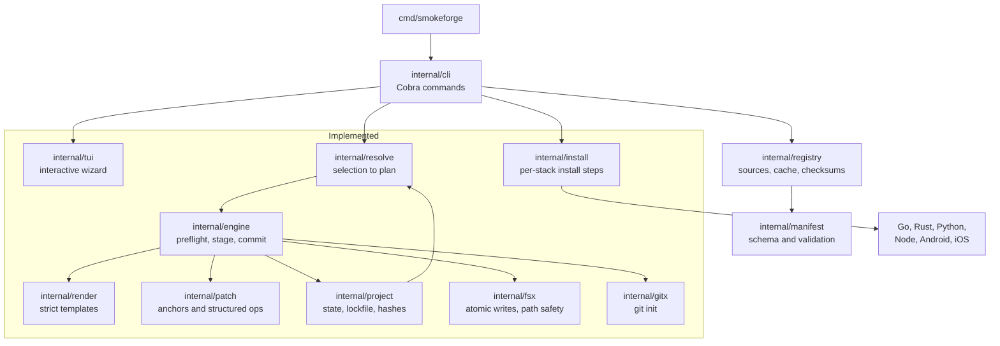
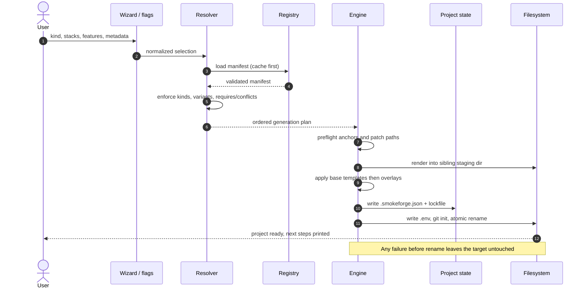
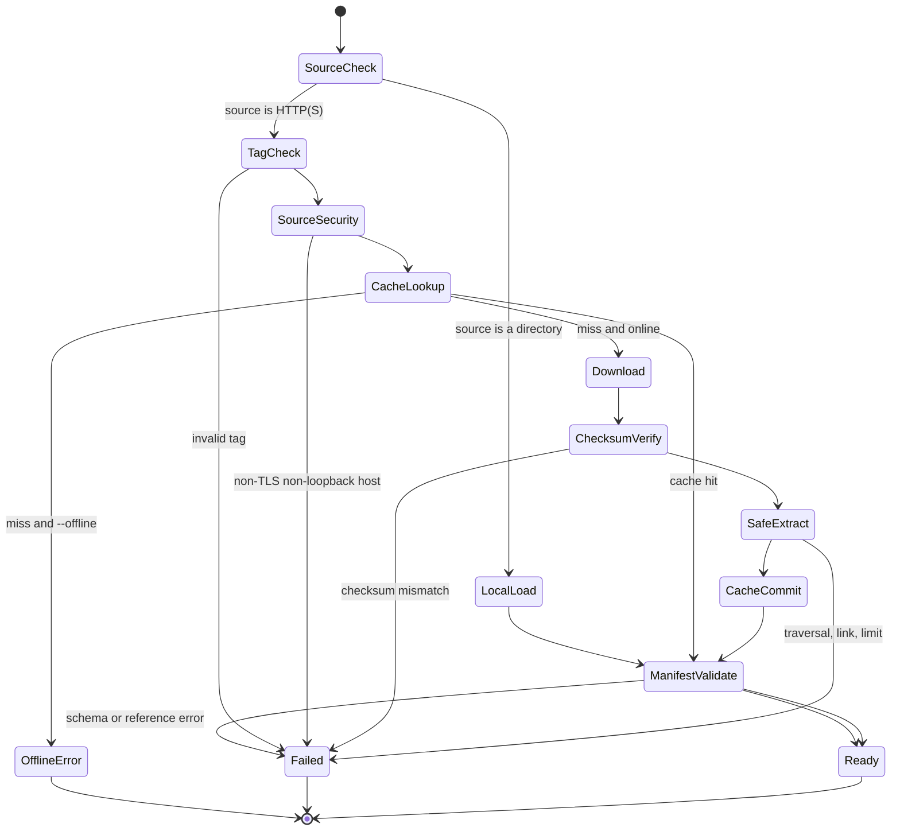
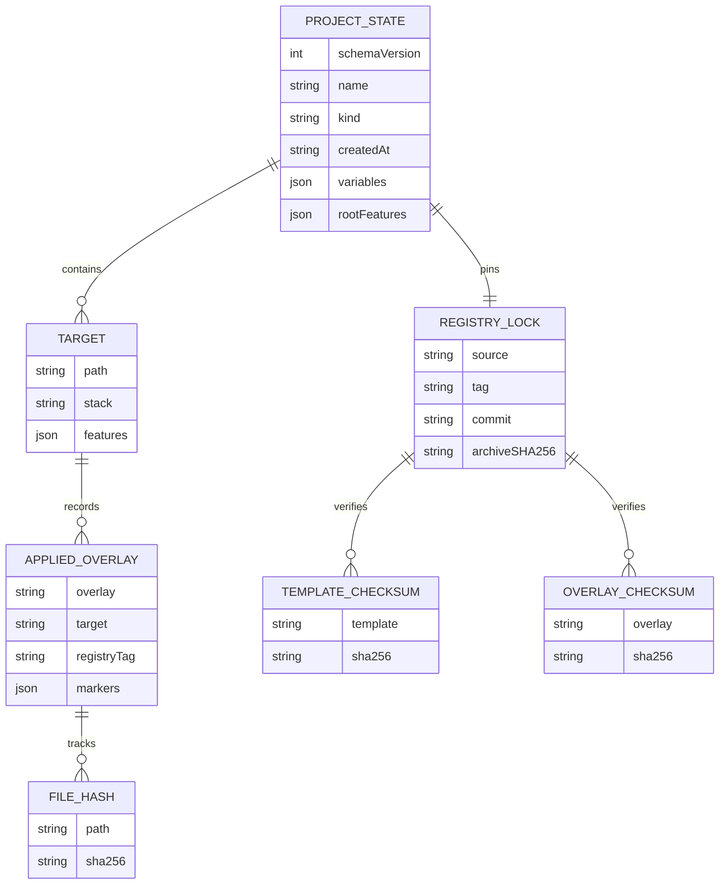
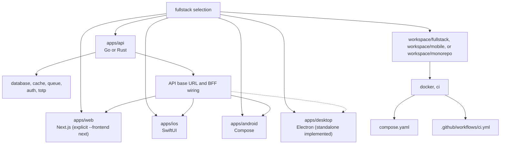
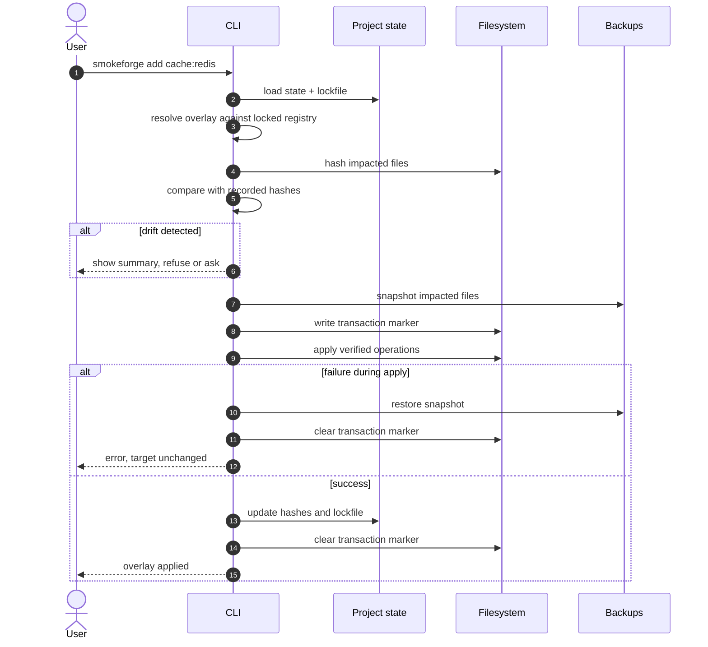
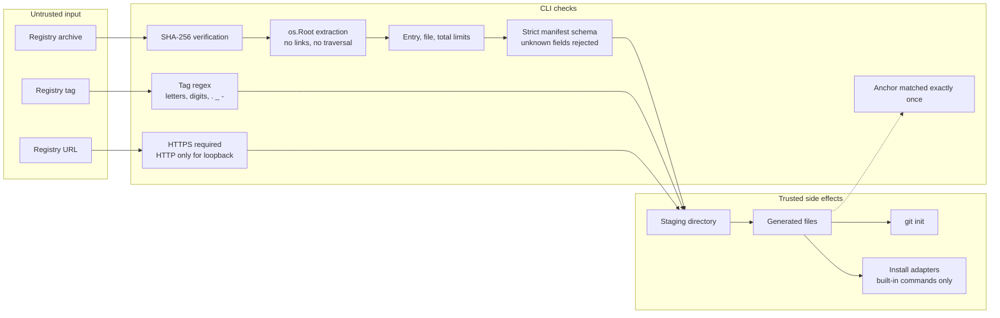
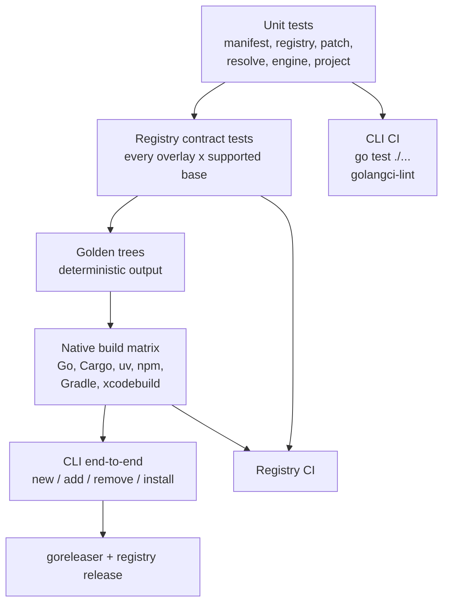

# smokeforge architecture

Visual companion to the prose architecture docs. Diagrams distinguish
**implemented** infrastructure from **planned** generation behavior, matching the
[status legend](README.md#status-legend).

Related reading:

- [System overview](architecture/overview.md)
- [CLI and lifecycle](architecture/cli.md)
- [Generation engine](architecture/generation-engine.md)
- [Registry manifest](registry/manifest.md)
- [Overlay model](registry/overlays.md)

---

## 1. System context



Trust boundary: the registry is remote and untrusted. Everything it contains is
declarative; the CLI decides what is written and never executes template code.

---

## 2. Component map



Dependency rule: `cli` depends on libraries; libraries never import `cli`.
`engine` is the only package that mutates targets. `manifest` never performs
network I/O.

---

## 3. New project sequence



---

## 4. Registry resolution state machine



Cache entry key: `sha256(source + NUL + tag)` truncated to 16 hex characters.
Cache commits are atomic: download to a temp directory, verify, extract, then
rename into place.

---

## 5. Overlay composition

```mermaid
flowchart LR
    base["Base template\ngo/gin-layered, rust, python,\nnext, swiftui, compose,\ngpui, egui"] --> render["Strict render\nvariables + secrets"]
    render --> anchors["Anchored file tree\nsmokeforge:anchor imports\nsmokeforge:anchor routes"]

    subgraph overlays["Feature overlays (dependency ordered)"]
        db["database:postgres"]
        cache["cache:redis"]
        queue["queue:rabbitmq"]
        auth["auth:jwt"]
        totp["totp\nrequires auth:jwt"]
        infra["docker + ci:github"]
    end

    anchors --> ops["Declarative operations\naddFiles\ninsertBefore/After\npatchJSON/YAML/TOML\naddDependency\nenv"]
    overlays --> ops
    ops --> tree["Generated project"]

    subgraph markers["Reversible insertion"]
        begin["smokeforge:begin cache:redis"] --> code["generated block"] --> end["smokeforge:end cache:redis"]
    end
    ops -.-> markers
```

Every anchor must match exactly once. Insertions are idempotent and wrapped in
markers; structured patches are re-parsed after editing; dependency edits use
language-aware adapters.

---

## 6. Project data model



`FILE_HASH` records post-generation content so `add`/`remove` can detect drift
without touching user edits.

---

## 7. Fullstack composition



Root overlays aggregate services and workflows from target metadata. Overlays
may not write outside their declared target.

---

## 8. Mutation transaction (`add` / `remove`)



Interrupted mutations leave a transaction marker and backup so `doctor` can
report recovery steps.

---

## 9. Trust boundaries



Templates cannot execute shell commands. `smokeforge install` uses built-in,
per-stack adapters rather than command strings from the registry.

---

## 10. Testing and CI



Full testing details: [testing strategy](development/testing.md).

---

## Status map

| Diagram area | Status |
| --- | --- |
| CLI entrypoint, version, list, registry, doctor | Implemented |
| Manifest validation | Implemented |
| Local and remote registry loading, checksums, cache, safe extraction | Implemented |
| Resolver, renderer, patch engine, staging, state/lock, wizard | Implemented (M2) |
| Base templates and feature overlays | Implemented (M3: API + Next.js) |
| Add/remove lifecycle, drift, backups, rollback | Implemented (M4 lifecycle) |
| Install | Planned (M4 remainder) |
| Release pipeline | Implemented (M5) |
